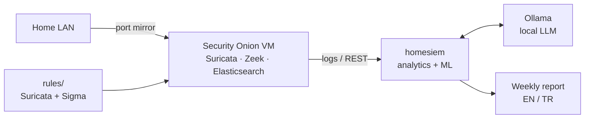
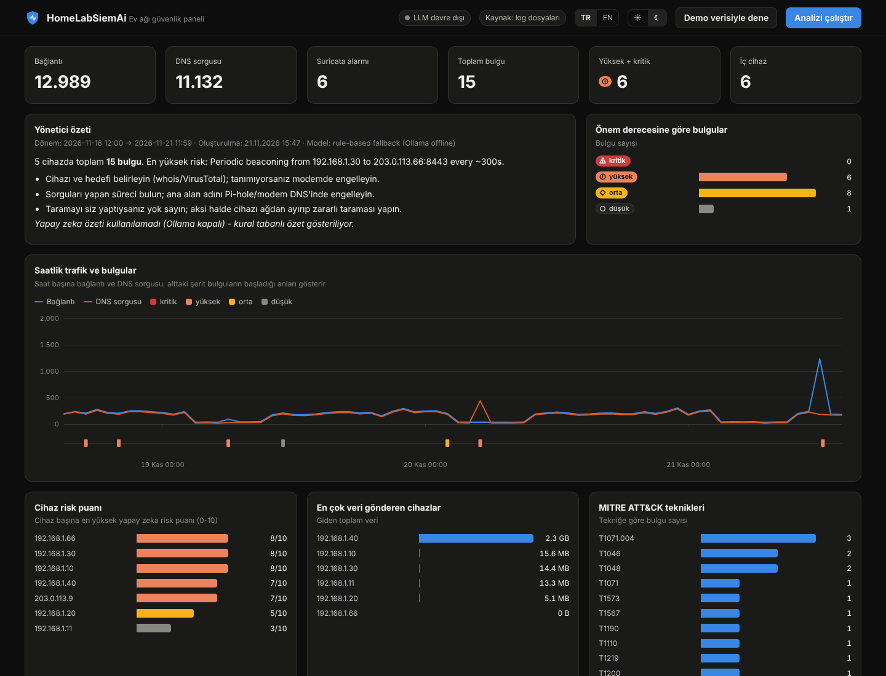

# HomeLabSiemAi

**🇬🇧 English** | [🇹🇷 Türkçe](README.tr.md)


A home-lab **SIEM** built on **Security Onion** (Suricata + Zeek + Elasticsearch) with
**custom detection rules for home-network threats** and a **local AI assistant** (Ollama)
that triages alerts, explains them in plain language and writes a weekly security report
in English or Turkish. Nothing leaves the house.





## Features

- **18 custom Suricata rules** for home threats: LAN scans, DNS bypass & DoH, DNS tunneling,
  inbound Telnet/RDP exposure, SSH brute force, remote-access scams (AnyDesk/TeamViewer),
  crypto-mining, Tor, EXE over HTTP ... - every rule mapped to MITRE ATT&CK and **replay-tested in CI**.
- **8 Sigma rules** on Zeek logs (dynamic DNS, long TXT queries, mining pools, scripting user agents, ...).
- **Behavioural analytics** that signatures can't do: C2 beaconing, DNS-tunnel entropy, port scans,
  night-time exfiltration, unknown devices (asset inventory diff).
- **Machine learning**: Isolation Forest anomaly detection per host and hour, with explanations.
- **Local LLM (Ollama)**: risk score 1-10, explanation, recommended action, executive summary and
  a `homesiem ask "..."` Q&A command. Prompt-injection-aware; falls back to rule-based triage when offline.
- **Web panel** (`homesiem serve`): KPIs, hourly traffic with finding markers, device risk, top uploaders,
  MITRE coverage, filterable findings table with AI analysis + evidence, "Ask the AI" box, run analysis
  with one click. TR/EN, light/dark, stdlib-only server bound to localhost with CSP and DNS-rebinding protection.
- **Reporting**: Markdown report + `findings.json`, English 🇬🇧 or Turkish 🇹🇷.
- **Detection-as-code**: GitHub Actions run lint, unit tests, `sigma check`, Suricata syntax check and PCAP replay.
- **Privacy tooling**: `scripts/sanitize_logs.py` pseudonymises IPs, MACs and hostnames before anything is shared.

## Quick start (2 minutes, no Security Onion needed)

```bash
git clone https://github.com/alpkcgl342/HomeLabSiemAi.git
cd HomeLabSiemAi/ai-assistant
pip install -r requirements.txt
python -m homesiem --no-llm demo          # synthetic 3-day home network with 5 attacks
# -> reports/report-YYYY-MM-DD.en.md
python -m homesiem --no-llm -l tr demo    # Turkish report
```

With the local LLM:

```bash
docker compose up -d ollama
docker compose exec ollama ollama pull llama3.1:8b
docker compose run --rm assistant demo
docker compose run --rm assistant ask "Which device is the most suspicious and why?"
```

Web panel:

```bash
python -m homesiem --no-llm serve            # http://127.0.0.1:8080 -> "Try with demo data"
# or with Docker (Ollama + panel):
docker compose up -d ollama panel            # http://localhost:8080
```

Example output: [docs/report/sample-report.en.md](docs/report/sample-report.en.md)

## Full setup

1. [Install Security Onion in a VM and mirror your home traffic](docs/setup-security-onion.md)
2. Load the rules from [`rules/`](rules/) via *Detections*
3. Copy `config/config.example.yaml` → `config/config.yaml`, `assets.example.yaml` → `assets.yaml`
4. Fetch logs (`scripts/fetch_so_logs.sh`) or point the assistant at Elasticsearch
5. `docker compose up -d ollama panel` → open http://localhost:8080 and press **Run analysis**
6. [Test the detections](docs/testing-detections.md) with `scripts/simulation/run_safe_tests.sh`

## Repository layout

```
HomeLabSiemAi/
├── ai-assistant/            # Python package "homesiem" (+ Dockerfile, tests)
│   └── homesiem/
│       ├── sources.py       # Zeek/Suricata files or Security Onion Elasticsearch
│       ├── analytics/       # beaconing, dns, network, anomaly (ML)
│       ├── llm.py           # Ollama: triage, summary, Q&A
│       ├── report.py        # Markdown/JSON report (EN/TR)
│       ├── web.py           # local web panel (templates/dashboard.html)
│       └── demo.py          # synthetic dataset with injected attacks
├── rules/
│   ├── suricata/homenet.rules
│   ├── sigma/zeek/*.yml
│   └── tests/               # Scapy PCAP generator + replay test
├── scripts/                 # fetch_so_logs.sh, sanitize_logs.py, simulation/
├── config/config.example.yaml
├── assets.example.yaml      # trusted-device inventory
├── docs/                    # architecture, setup, detection catalog, testing, reports
├── docker-compose.yml       # Ollama + assistant
└── .github/workflows/ci.yml
```

## Documentation

| Document | Content |
|---|---|
| [Architecture](docs/architecture.md) | Components, data flow, why a local LLM, AI security |
| [Security Onion setup](docs/setup-security-onion.md) | Hardware, port mirroring, VM, rules, connecting the assistant |
| [Detection catalog](docs/detection-catalog.md) | Every rule/analytic with MITRE ATT&CK mapping |
| [Testing detections](docs/testing-detections.md) | CI replay tests, live simulation, tuning |
| [Project report (TR)](docs/report/project-report.tr.md) | Full project write-up in Turkish |

## Ethics & privacy

- Monitor **only networks you own**, and tell the people living with you that traffic is monitored.
- Never commit real logs, PCAPs, `assets.yaml` or credentials (`.gitignore` blocks them). Use `sanitize_logs.py`.
- The simulation script only targets your own devices and asks for confirmation.
- AI output can be wrong; always verify findings in Security Onion.

## Roadmap

- [ ] GeoIP / threat-intel enrichment (abuse.ch, AlienVault OTX) before LLM triage
- [ ] Push high-risk findings to Telegram / e-mail
- [ ] Automatic Sigma rule suggestion from confirmed findings (LLM-assisted)
- [ ] Grafana / HTML dashboard for the report history

## License

[MIT](LICENSE)
