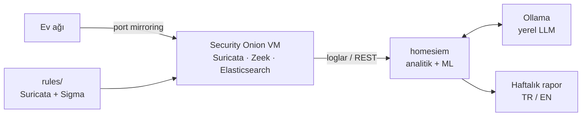
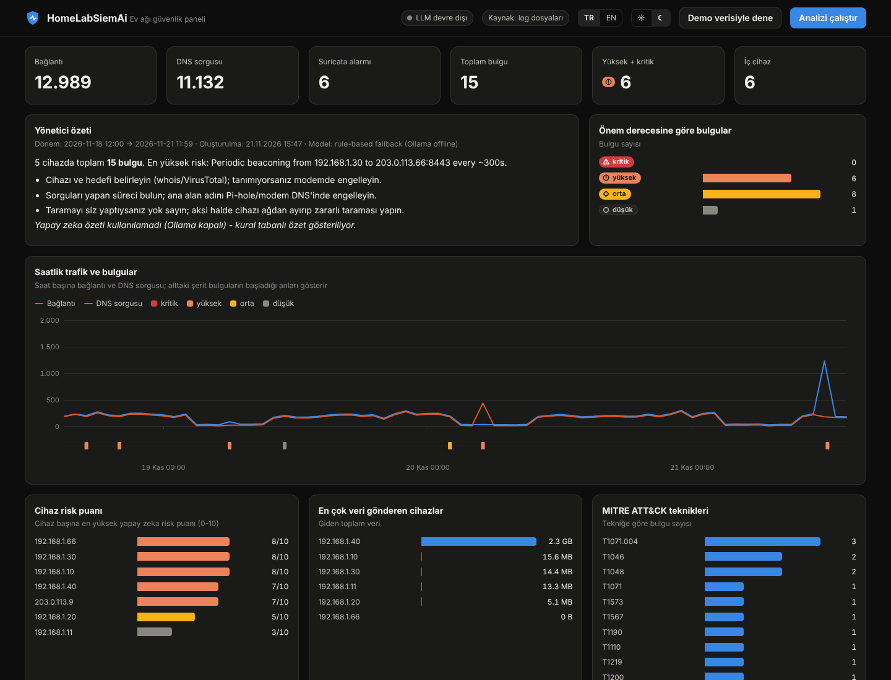

# HomeLabSiemAi

[🇬🇧 English](README.md) | **🇹🇷 Türkçe**


**Security Onion** (Suricata + Zeek + Elasticsearch) üzerine kurulu bir ev laboratuvarı **SIEM**
projesi. Ev ağına yönelik tehditler için **özel tespit kuralları** ve alarmları önceliklendiren,
sade bir dille açıklayan ve haftalık güvenlik raporunu Türkçe ya da İngilizce yazan **yerel bir
yapay zeka asistanı** (Ollama) içerir. Hiçbir veri evden dışarı çıkmaz.





## Özellikler

- **18 özel Suricata kuralı**: ağ içi tarama, DNS atlatma ve DoH, DNS tünelleme, internetten gelen
  Telnet/RDP erişimi, SSH kaba kuvvet, uzaktan erişim dolandırıcılığı (AnyDesk/TeamViewer),
  kripto madenciliği, Tor, HTTP üzerinden EXE indirme. Her kural MITRE ATT&CK ile eşlenmiştir
  ve **CI'da PCAP tekrar oynatılarak test edilir**.
- Zeek logları için **8 Sigma kuralı**: dinamik DNS, uzun TXT sorguları, madencilik havuzları,
  script user-agent'ları gibi senaryolar.
- İmzaların yakalayamadığı **davranışsal analizler**: C2 beaconing, DNS tünelleme entropisi, port
  taraması, gece veri sızdırma, envanterde olmayan cihazlar.
- **Makine öğrenmesi**: cihaz/saat bazında Isolation Forest ile anomali tespiti (gerekçeleriyle).
- **Yerel LLM (Ollama)**:
  - 1-10 arası risk puanı, açıklama, önerilen aksiyon ve yönetici özeti üretir.
  - `homesiem ask "..."` komutuyla sorulara cevap verir.
  - Prompt injection'a karşı önlemlidir. Ollama kapalıysa kural tabanlı triyaja geçer.
- **Web paneli** (`homesiem serve`):
  - Özet göstergeler, bulgu işaretli saatlik trafik grafiği, cihaz risk puanları, en çok veri gönderen cihazlar ve MITRE kapsamı.
  - Filtrelenebilir bulgu tablosu (yapay zeka analizi ve kanıtlarla), "Yapay zekaya sor" kutusu ve tek tıkla analiz.
  - TR/EN, açık/koyu tema. Yalnızca localhost'ta çalışır; CSP ve DNS rebinding korumalıdır.
- **Raporlama**: Markdown rapor + `findings.json`, Türkçe 🇹🇷 veya İngilizce 🇬🇧.
- **Detection-as-code**: GitHub Actions; lint, birim testleri, `sigma check`, Suricata sözdizimi
  kontrolü ve PCAP tekrar testi çalıştırır.
- **Gizlilik araçları**: `scripts/sanitize_logs.py` paylaşımdan önce IP, MAC ve cihaz adlarını
  takma adlarla değiştirir.

## Hızlı başlangıç (2 dakika, Security Onion gerekmez)

```bash
git clone https://github.com/alpkcgl342/HomeLabSiemAi.git
cd HomeLabSiemAi/ai-assistant
pip install -r requirements.txt
python -m homesiem --no-llm -l tr demo    # 5 saldırı içeren 3 günlük sentetik ev ağı
# -> reports/report-YYYY-MM-DD.tr.md
```

Yerel LLM ile:

```bash
docker compose up -d ollama
docker compose exec ollama ollama pull llama3.1:8b
docker compose run --rm -e HOMESIEM_LANGUAGE=tr assistant demo
docker compose run --rm -e HOMESIEM_LANGUAGE=tr assistant ask "En şüpheli cihaz hangisi ve neden?"
```

Web paneli:

```bash
python -m homesiem --no-llm -l tr serve      # http://127.0.0.1:8080 -> "Demo verisiyle dene"
# veya Docker ile (Ollama + panel):
docker compose up -d ollama panel            # http://localhost:8080
```

Örnek çıktı: [docs/report/sample-report.tr.md](docs/report/sample-report.tr.md)

## Tam kurulum

1. [Security Onion'ı sanal makineye kurun ve ev trafiğini yansıtın](docs/setup-security-onion.md)
   (doküman İngilizce; adımlar proje raporunda Türkçe özetlenmiştir)
2. [`rules/`](rules/) klasöründeki kuralları *Detections* ekranından ekleyin
3. `config/config.example.yaml` → `config/config.yaml`, `assets.example.yaml` → `assets.yaml` olarak kopyalayıp düzenleyin
4. Logları çekin (`scripts/fetch_so_logs.sh`) ya da asistanı doğrudan Elasticsearch'e bağlayın
5. `docker compose up -d ollama panel` ile paneli başlatın, http://localhost:8080 adresini açıp **Analizi çalıştır**'a basın
6. `scripts/simulation/run_safe_tests.sh` ile [tespitleri test edin](docs/testing-detections.md)

## Klasör yapısı

```
HomeLabSiemAi/
├── ai-assistant/            # "homesiem" Python paketi (+ Dockerfile, testler)
│   └── homesiem/
│       ├── sources.py       # Zeek/Suricata dosyaları veya Security Onion Elasticsearch
│       ├── analytics/       # beaconing, dns, network, anomaly (ML)
│       ├── llm.py           # Ollama: triyaj, özet, soru-cevap
│       ├── report.py        # Markdown/JSON rapor (TR/EN)
│       ├── web.py           # yerel web paneli (templates/dashboard.html)
│       └── demo.py          # saldırı senaryolu sentetik veri
├── rules/
│   ├── suricata/homenet.rules
│   ├── sigma/zeek/*.yml
│   └── tests/               # Scapy PCAP üretici + tekrar oynatma testi
├── scripts/                 # fetch_so_logs.sh, sanitize_logs.py, simulation/
├── config/config.example.yaml
├── assets.example.yaml      # güvenilen cihaz envanteri
├── docs/                    # mimari, kurulum, kural kataloğu, test, raporlar
├── docker-compose.yml       # Ollama + asistan
└── .github/workflows/ci.yml
```

## Dokümantasyon

| Doküman | İçerik |
|---|---|
| [Proje raporu](docs/report/project-report.tr.md) | Projenin Türkçe raporu: amaç, mimari, kurallar, sonuçlar |
| [Mimari](docs/architecture.md) | Bileşenler, veri akışı, yerel LLM tercihi |
| [Security Onion kurulumu](docs/setup-security-onion.md) | Donanım, port mirroring, VM, kurallar |
| [Tespit kataloğu](docs/detection-catalog.md) | Tüm kurallar ve MITRE ATT&CK eşlemesi |
| [Tespitlerin test edilmesi](docs/testing-detections.md) | CI testleri, canlı simülasyon, ince ayar |

## Etik ve gizlilik

- **Sadece size ait ağları** izleyin ve evde yaşayanları trafiğin izlendiği konusunda bilgilendirin
  (KVKK açısından da önemlidir).
- Gerçek logları, PCAP dosyalarını, `assets.yaml` dosyasını ya da şifreleri asla repoya göndermeyin.
  `.gitignore` bunları engeller; paylaşmadan önce `sanitize_logs.py` kullanın.
- Simülasyon scripti yalnızca kendi cihazlarınızı hedef alır ve başlamadan önce onay ister.
- Yapay zeka yanılabilir. Bulguları her zaman Security Onion üzerinden doğrulayın.

## Yol haritası

- [ ] LLM triyajından önce GeoIP / tehdit istihbaratı zenginleştirmesi (abuse.ch, AlienVault OTX)
- [ ] Yüksek riskli bulguların Telegram / e-posta ile bildirilmesi
- [ ] Doğrulanmış bulgulardan otomatik Sigma kuralı önerisi (LLM destekli)
- [ ] Rapor geçmişi için Grafana / HTML dashboard

## Lisans

[MIT](LICENSE)
