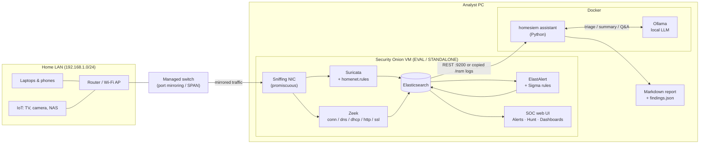

# Architecture

## Layers

| Layer | Component | Role |
|---|---|---|
| Capture | Managed switch with port mirroring (or a TAP) | Copies every packet of the home LAN to the sensor NIC |
| Sensor | Suricata | Signature-based NIDS; runs ET Open + this repo's `rules/suricata/homenet.rules` |
| Sensor | Zeek | Protocol metadata (connections, DNS, DHCP, HTTP, TLS) |
| SIEM | Security Onion (Elasticsearch, SOC, ElastAlert) | Storage, search, dashboards, Sigma rule engine, case management |
| Detection-as-code | `rules/` + GitHub Actions | Rules live in Git, are syntax-checked and replay-tested on every push |
| Analytics | `homesiem.analytics` | Behavioural detections signatures can't express: beaconing, DNS tunneling, scans, exfiltration, rogue devices, ML anomalies |
| AI | Ollama + `homesiem.llm` | Risk scoring, plain-language explanation, recommended action, executive summary, chat-style Q&A |
| Reporting | `homesiem.report` | Weekly Markdown report (EN/TR) + machine-readable `findings.json` |

## Why a *local* LLM?

Home traffic reveals who is home, which sites the family visits and which devices exist.
Sending it to a cloud API would create exactly the privacy problem a SIEM is supposed to
prevent. Ollama runs the model on the same PC; nothing leaves the house. Only the
top-N findings (not raw logs) are given to the model, which keeps prompts small enough
for 7-8B models on a laptop CPU.

## Detection layers and how they complement each other

1. **Suricata signatures** - precise, packet-level, real time (e.g. inbound Telnet, DoH, Stratum).
2. **Sigma rules on Zeek logs** - log-level patterns (dynamic DNS, long TXT queries, scripting user-agents), portable to any SIEM.
3. **Python analytics** - statistics over time windows (periodicity, entropy, volume, inventory diff).
4. **Isolation Forest** - unsupervised "this doesn't look like your network" signal.
5. **LLM triage** - correlates the above, filters likely false positives and explains them to a non-expert.

## Security of the AI component

* Log fields are attacker-controlled (a DHCP hostname can be `ignore previous instructions...`).
  They are passed to the model only as JSON data, and the system prompt instructs the model to
  treat them as untrusted. The model's output is **never executed**, only written to the report.
* Ollama is published on `127.0.0.1` only.
* The assistant reads Elasticsearch with a read-only account.
